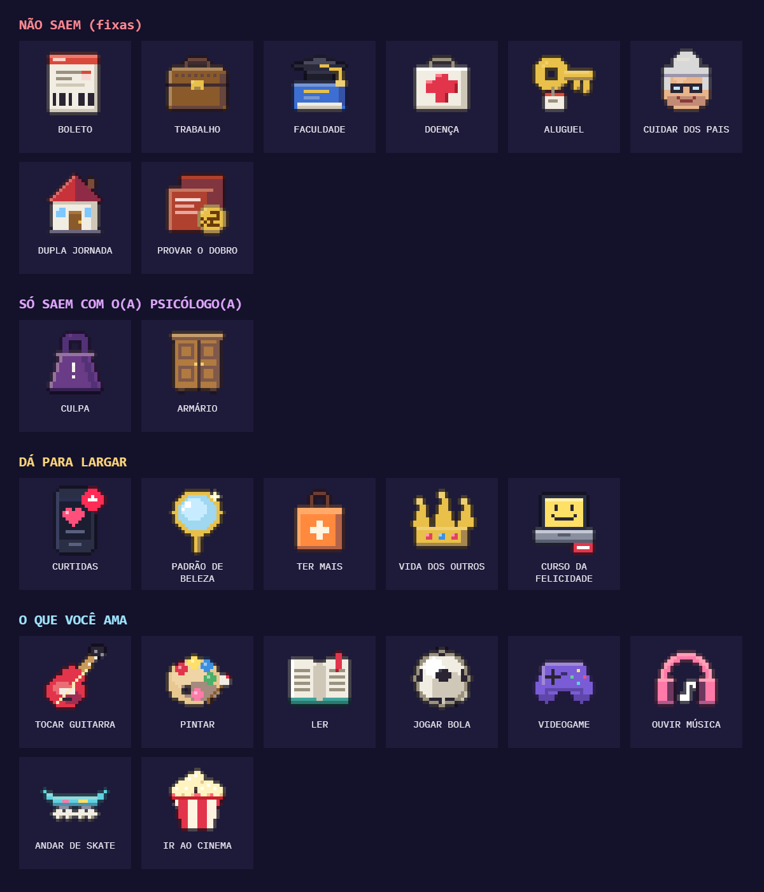

# Rumo à Saúde Mental: o que é cada carga

Guia dos ícones que caem na cabeça da personagem: o que cada desenho mostra, quem recebe, como sai da pilha e o que representa. A partir da v6 os ícones ganharam mais detalhe. Na v5 (hyratecnologia.com/rumo-a-saude-mental1) são os mesmos objetos, desenhados de forma mais simples.

## Como ler o jogo

- Quando algo cai na pilha, aparece um balão com o nome: **vermelho** para as cargas que não saem, **dourado** para as que dá para largar e **azul** para o que você ama.
- Cada carga pesa 1 (a **culpa** pesa 2). Quanto mais peso, mais lenta a personagem fica, mais baixo ela pula e mais forte é a pressão (batimento, tela escurecendo, crises).
- O que você ama **não pesa** e **alivia** a pressão.
- O botão **LARGAR** (tecla E) solta o item mais alto da pilha que pode sair.

---

## 1. Cargas que não saem

Pressões estruturais: não se resolvem com força de vontade, por isso não dá para largar. Toda vez que uma delas cai na pilha, a pressão empurra para fora uma coisa que você ama.

| Ícone | Nome no jogo | O que o desenho mostra | Quem recebe | O que representa |
|---|---|---|---|---|
| Papel com faixa vermelha e código de barras | **BOLETO** | Uma conta a pagar | Todo mundo. A pessoa pobre recebe mais vezes e **já começa com um** (aparece "JÁ VEIO COM VOCÊ") | Contas, dívidas, aperto financeiro |
| Maleta marrom com fecho dourado | **TRABALHO** | Uma pasta de trabalho | Todo mundo | Emprego, sustento, carga de trabalho |
| Livro azul com chapéu de formatura (capelo) | **FACULDADE** | Estudo e diploma | Todo mundo | Cobrança dos estudos, provas, formação |
| Maleta branca de primeiros socorros com cruz vermelha | **DOENÇA** | Saúde física | Todo mundo | Doença, tratamento, cuidado com o próprio corpo |
| Chave dourada com etiqueta | **ALUGUEL** | A chave da casa | Todo mundo | Custo de morar, moradia |
| Rosto de pessoa idosa de cabelo branco e óculos | **CUIDAR DOS PAIS** | Um pai ou uma mãe idosos | Todo mundo | Cuidar de familiares: trabalho de cuidado, muitas vezes sem pausa e sem pagamento |
| Casinha de telhado vermelho | **DUPLA JORNADA** | A casa | Só mulheres | O trabalho doméstico que se soma ao trabalho de fora |
| Dois papéis vermelhos com selo dourado "2X" | **PROVAR O DOBRO** | Um currículo/certificado em dobro | Só pessoas negras | Ter que provar o dobro de competência por causa do racismo |
| Rosto de criança (dois ícones) | **FILHOS** / **CRECHE** | Uma criança | Só com a opção "filhos" (hoje desligada) | Cuidar dos filhos e não ter onde deixá-los |

## 2. Cargas que só saem com o(a) psicólogo(a) por perto

Coisas que a pessoa sozinha não consegue soltar, mas que a terapia ajuda a largar. Com o(a) psicólogo(a) ao lado, elas **brilham em verde** e o LARGAR funciona. Ao soltar, aparece "CULPA LARGADA" ou "ARMÁRIO LARGADO".

| Ícone | Nome no jogo | O que o desenho mostra | Quem recebe | O que representa |
|---|---|---|---|---|
| Peso roxo de academia com "!" | **CULPA** (pesa o dobro) | Um peso | Jogada pelo chefão Mercado de Trabalho, com a fala "A CULPA É SUA" | A culpabilização individual: o sistema cobra e diz que a falha é sua |
| Guarda-roupa de madeira com duas portas | **ARMÁRIO** | Um armário fechado | Só pessoas LGBT+, de tempos em tempos | "Estar no armário": esconder quem se é por medo de rejeição |

## 3. Cargas que dá para largar a qualquer hora

Pressões sociais e culturais. Pesam igual, mas podem ser soltas com o LARGAR. Também são as que a multidão joga em você.

| Ícone | Nome no jogo | O que o desenho mostra | O que representa |
|---|---|---|---|
| Celular com coração rosa e notificação vermelha | **CURTIDAS** | Uma rede social | Precisar da aprovação dos outros, viver de likes |
| Espelho de mão dourado com brilho | **PADRÃO DE BELEZA** | Um espelho | A cobrança estética, o corpo "certo" |
| Sacola de compras laranja com "+" | **TER MAIS** | Compras | Consumismo: achar que ter mais traz felicidade |
| Coroa dourada com pedras | **VIDA DOS OUTROS** | A vida "de rei" dos outros | Comparação: a vida perfeita que os outros mostram (e que ninguém vive de verdade) |
| Notebook com tela amarela sorridente e etiqueta de preço | **CURSO DA FELICIDADE** | Um curso on-line. Ao pegar, aparece "SÓ 12X DE R$ 97!" | A felicidade vendida como produto: coach, fórmula pronta, autoajuda de vitrine |

## 4. O que você ama

Hobbies e diversão: o que dá prazer e sustenta a saúde mental. Brilham de leve na pilha.

| Ícone | Nome no jogo | O que o desenho mostra |
|---|---|---|
| Guitarra vermelha | **TOCAR GUITARRA** | Música |
| Paleta de tintas com pincel | **PINTAR** | Arte |
| Livro aberto com marcador vermelho | **LER** | Leitura |
| Bola de futebol | **JOGAR BOLA** | Esporte |
| Controle de videogame roxo | **VIDEOGAME** | Jogos |
| Fone de ouvido rosa com nota musical | **OUVIR MÚSICA** | Música |
| Skate azul-claro | **ANDAR DE SKATE** | Lazer ao ar livre |
| Balde de pipoca listrado | **IR AO CINEMA** | Passeio, cultura |

**Como funcionam:**
- Não pesam e **aliviam** a pressão (cada um reduz o batimento e as crises).
- **A pressão os tira de você:** quando cai uma carga fixa, ou quando você bate numa barreira, a personagem perde um deles e aparece "VOCÊ LARGOU: [ITEM]".
- Também **dá para largá-los de propósito** com o LARGAR: abrir mão do que se ama para dar conta também é uma escolha que as pessoas fazem.
- Com o(a) psicólogo(a) por perto, você **não perde** o que ama.
- **No final, ninguém carrega o que você ama:** as outras pessoas dividem as cargas, mas os hobbies continuam com a personagem.

---

## Outros símbolos na tela

| Elemento | O que representa |
|---|---|
| Corações (canto esquerdo, "saúde mental") | A saúde mental da personagem. Perde ao bater em barreiras comuns e nas metas do chefão |
| Muro roxo de tijolos que fecha a rua (RACISMO, MACHISMO, LGBTFOBIA, SEM RAMPA…) | Barreiras sociais: não dá para pular nem desviar, porque não dependem de quem passa |
| Barreiras comuns (despertador PRAZO, gráfico META, porta VAGA PREENCHIDA…) | Pressões do dia a dia. Dá para pular ou desviar |
| Pessoas de máscara branca sorridente | A felicidade de vitrine. Quando a máscara levanta, aparece uma lágrima |
| Placa verde "SAÚDE MENTAL" que sempre se afasta | Saúde mental não é linha de chegada |
